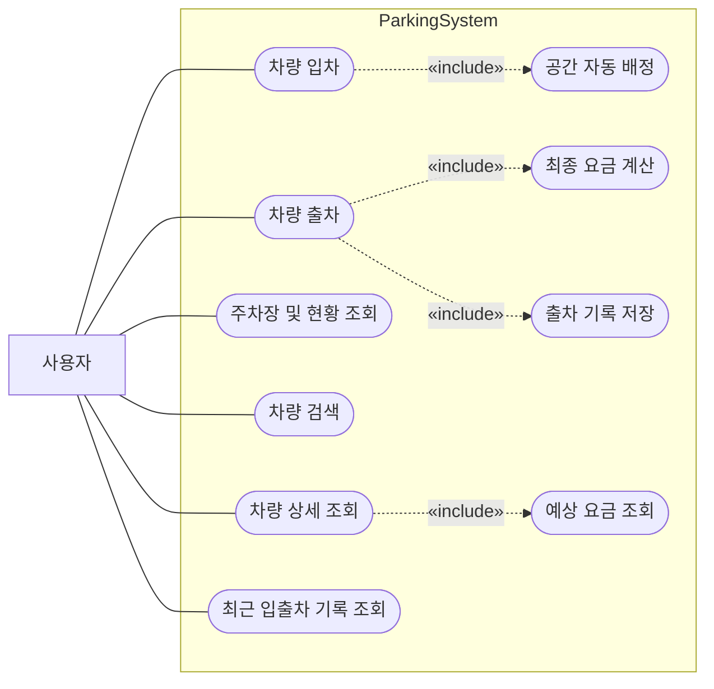
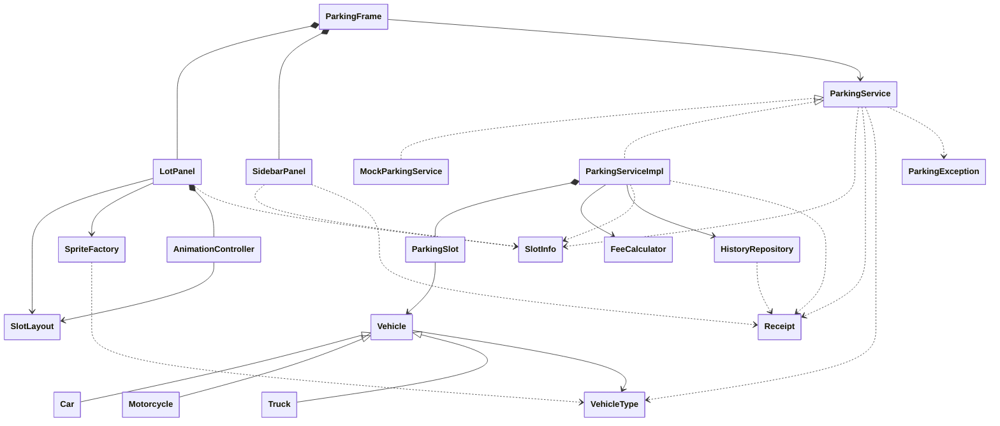

# 소프트웨어공학 프로젝트 작업 명세서

**Software Requirements Specification (SRS)**

| 항목       | 내용                                            |
| ---------- | ----------------------------------------------- |
| 프로젝트명 | Java 기반 2D 주차장 관리 시스템 (ParkingSystem) |
| 문서       | 1차 제출본 (v0.2)                               |
| 백엔드     | 박준후 (2024245122)                             |
| 프론트엔드 | 조현국 (2021240487)                             |
| GitHub     | https://github.com/hyeongukjo/ParkingSystem     |

본 문서는 프로젝트 제안서를 바탕으로 프로그램의 요구사항, 데이터 규격 및 팀원 간 인터페이스를 구체화한다. 공용 인터페이스는 유지하며, 개발 범위와 세부 설계는 팀원 간 협의를 통해 수정 및 보완한다. 개발 과정에서 변경되는 사항은 본 문서에 반영한다.

## 1. 프로젝트 개요

### 1.1 개발 목적

차량 입차, 주차 공간 자동 배정, 차량 검색, 출차 및 요금 계산을 하나의 프로그램에서 관리한다. Java Swing과 Graphics2D를 이용하여 주차장을 위에서 내려다보는 탑다운(Top-down) 방식으로 표현하고, 차량이 주차 공간으로 이동하거나 출구로 이동하는 과정을 시각적으로 제공한다.

차량 정보, 주차 공간, 요금 계산, 기록 저장 등을 객체 단위로 분리하고 프론트엔드와 백엔드는 하나의 공용 인터페이스인 `ParkingService`를 통해 연동한다. 이를 통해 각 모듈의 내부 구현에 대한 의존성을 줄이고 두 팀원이 독립적으로 개발할 수 있도록 한다.

### 1.2 개발 환경 및 범위

| 항목              | 명세                                                              |
| ----------------- | ----------------------------------------------------------------- |
| 개발 언어 및 도구 | Java, Eclipse                                                     |
| GUI               | Java Swing, Graphics2D 커스텀 렌더링 (외부 UI 라이브러리 미사용)  |
| 애니메이션        | javax.swing.Timer                                                 |
| 주차장 규모       | 총 40개 주차 공간                                                 |
| 주차장 구성       | A, B, C, D 총 4개 구역, 구역별 10개 공간                          |
| 주차 공간 식별자  | A-01 ~ D-10                                                       |
| 지원 차종         | 승용차, 트럭, 이륜차                                              |
| 데이터 저장       | 현재 주차 상태는 실행 중 관리하며, 완료된 출차 기록은 파일에 저장 |
| 협업              | GitHub, Eclipse EGit을 이용한 Pull/Commit/Push                    |

사용자는 GUI에서 입차 시 차량번호와 차종을, 출차 및 검색 시 차량번호를 입력하여 요청한다.

### 1.3 주차장 구성

주차장은 지상 1층을 기준으로 A, B, C, D의 4개 구역으로 구성하며, 각 구역에는 10개의 주차 공간을 배치한다.

- 전체 주차 공간: 40개
- 모든 주차 공간은 일반 주차 공간으로 동일하게 관리하며, 별도의 공간 유형 구분은 두지 않는다.
- 입구 및 출구: 각각 1개
- 주차 공간 식별자: A-01 ~ D-10

프론트엔드와 백엔드는 주차 공간 식별자를 기준으로 차량의 위치와 주차 상태를 관리한다. 실제 화면 좌표와 차량 이동 경로는 프론트엔드에서 관리한다.

### 1.4 화면 구성 (초기 UI 설계안)


| 영역 | 구성 및 기능 |
| --- | --- |
| 상단 헤더 | 프로그램명, 범례(빈자리·사용 중·선택/배정), 현재 날짜와 시각 |
| 주차장 맵 (좌측) | A~D 구역 40개 공간, 차로, 입구(IN)·출구(OUT) 차단봉, 화단을 탑다운 방식으로 렌더링. 차량 클릭 시 상세 말풍선 표시 |
| 실시간 현황 (우측 상단) | 점유율(%), 사용 중/전체 공간 수, 공간 1개당 1칸으로 표시하는 점유 막대, 빈자리 수, 오늘 매출 |
| 입력 영역 (우측 중앙) | 차량번호 입력창, 차종 선택(승용·트럭·이륜), 입차·출차·검색 버튼, 입력 오류 안내 문구 |
| 최근 입출차 (우측 하단) | 최근 입차·출차 기록 최대 5건 (차량번호, 차종, 시각, 출차 요금) |

## 2. 기능적 요구사항 FR (Functional Requirement)

| ID    | 기능                  | 상세 요구사항                                                                                                                                                        |
| ----- | --------------------- | -------------------------------------------------------------------------------------------------------------------------------------------------------------------- |
| FR-01 | 차량 입차             | 차량번호와 차종을 입력받아 유효성을 검사하고, 현재 주차 중인 차량번호와 중복되지 않는 경우 입차를 등록한다. 차량번호, 차종, 입차 시각, 배정 공간을 관리한다.         |
| FR-02 | 공간 자동 배정        | 차종에 관계없이 이용 가능한 빈 공간을 식별자 순서에 따라 자동으로 배정한다. 빈 공간이 없으면(만차) 입차를 거부한다.                                                  |
| FR-03 | 차량 출차             | 차량번호 입력을 통해 출차를 요청한다. 차량이 존재하면 요금을 계산하고 기록을 저장한 후 공간을 비운다. 등록되지 않은 차량의 출차는 거부한다.                          |
| FR-04 | 주차장 시각화         | Graphics2D로 A~D 구역 40개 주차 공간, 차로, 입·출구, 화단 등을 탑다운 방식으로 렌더링한다. 차종별 도트 스프라이트(승용차·트럭·이륜차)로 점유 공간을 표시하고, 빈 공간은 초록 점으로 구분한다. |
| FR-05 | 입차 애니메이션       | 입차 성공 시 차량이 입구에서 배정 공간까지 이동한다. 이동 경로는 점선으로, 도착 공간은 테두리 강조 효과로 표시한다.                                                  |
| FR-06 | 출차 애니메이션       | 출차 성공 시 차량이 기존 주차 공간에서 출구까지 이동하고 애니메이션 종료 후 차량 그림을 제거한다.                                                                    |
| FR-07 | 주차 요금             | 입차 시각과 출차 시각의 차이를 기준으로 기본요금 및 추가요금을 계산한다. 모든 차종에 동일한 요금 정책을 적용한다. 출차 시 이용 시간과 최종 요금을 표시한다.          |
| FR-08 | 차량 검색             | 사이드바 입력창에 차량번호를 입력하고 검색 버튼을 누르면 현재 주차 중인 차량과 해당 공간을 찾아 주차장 맵에서 강조하고 상세 말풍선을 표시한다. 검색 결과가 없으면 사용자에게 안내한다. |
| FR-09 | 차량 상세 조회        | 주차된 차량을 클릭하면 번호판, 입차 시각, 경과 시간, 예상 요금을 말풍선으로 표시한다. 말풍선에서 해당 차량의 출차를 요청할 수 있다.                                  |
| FR-10 | 주차 현황             | 전체 공간 수, 사용 중인 공간 수, 빈 공간 수, 점유율 및 오늘 매출(`getHistory()` 중 당일 출차 기록의 요금 합계)을 사이드바에 표시한다. 입·출차에 따라 갱신한다. |
| FR-11 | 최근 입·출차 기록 | 프론트엔드는 `getSlots()`에서 현재 주차 중인 차량의 입차 기록을, `getHistory()`에서 출차가 완료된 차량의 입차 및 출차 기록을 가져와 최신순으로 최대 5건을 사이드바에 표시한다. |                       
| FR-12 | 기록 저장 및 조회     | 완료된 출차의 차량번호, 입차 시각, 출차 시각, 요금 등을 파일에 저장한다. 프로그램 재실행 후에도 완료된 기록을 조회할 수 있어야 한다.                                 |
| FR-13 | 오류 안내             | 입력 형식 오류, 중복 입차, 만차, 미등록 차량 출차 등의 상황을 사용자에게 안내한다. 실패한 요청은 정상적인 주차 상태를 변경하지 않는다. |

### 2.1 입차 처리

1. 사용자가 차량번호와 차종을 입력하여 입차를 요청한다.
2. 프론트엔드는 차량번호 형식과 차종 선택 여부를 확인하고 `ParkingService.enter(plate, type)`을 호출한다.
3. 백엔드는 입력값, 차량번호 중복 여부 및 빈 공간의 존재 여부를 검사한다.
4. 주차 공간 배정 규칙에 따라 빈 공간을 배정하고 차종에 맞는 차량 객체를 생성하여 입차 시각을 기록한다.
5. 배정된 공간의 `SlotInfo`를 반환한다.
6. 프론트엔드는 반환된 `slotId`의 화면 좌표까지 차량 이동 애니메이션을 실행하고, 종료 후 주차 현황을 갱신한다.
7. 실패한 경우 `ParkingException`을 처리하여 안내 메시지를 표시하며 애니메이션을 실행하지 않는다.

### 2.2 출차 처리

1. 사용자가 차량번호를 입력하거나 주차된 차량의 말풍선에서 출차를 요청한다.
2. 프론트엔드는 `ParkingService.exit(plate)`를 호출한다.
3. 백엔드는 해당 차량을 검색하고 입차 시각과 출차 시각을 기준으로 이용 시간 및 최종 요금을 계산한다.
4. 출차 기록을 저장하고 주차 공간을 해제한 뒤 `Receipt`를 반환한다.
5. 프론트엔드는 반환된 공간 번호(`slotId`)와 차종(`type`)을 이용해 애니메이션이 끝날 때까지 차량을 임시로 그리며 출차 애니메이션을 실행하고, 이용 시간과 최종 요금을 표시한다.
6. 애니메이션 종료 후 차량 그림을 제거하고 주차 현황 및 최근 기록을 갱신한다.
7. 미등록 차량 등 처리 실패 시 오류를 안내하고 출차 애니메이션을 실행하지 않는다.

### 2.3 차량 검색 및 상세 조회

차량번호 검색 시 `findByPlate(plate)`를 호출하여 검색된 차량의 주차 공간을 확인한다. 차량 그림을 클릭한 경우 해당 공간의 차량 정보를 조회하여 말풍선을 표시한다. 예상 요금은 백엔드에서 계산한 조회 시점의 요금으로 표시하고, 말풍선에서 출차를 요청하면 일반 출차 기능과 동일한 절차를 수행한다.

### 2.4 주차 요금 계산 규칙

요금은 기본요금과 기본시간 초과분에 대한 추가요금으로 구성하며, 모든 차종에 동일한 정책을 적용한다. 예상 요금과 최종 요금은 동일한 요금 계산 클래스를 이용하되, 각각 조회 시각과 실제 출차 시각을 기준으로 계산한다.

기본시간, 기본요금, 추가시간 단위, 추가요금, 시간 단위 올림 여부는 추후 협의.

### 2.5 주차 공간 배정 규칙

모든 주차 공간은 일반 주차 공간으로, 차종에 관계없이 동일한 규칙으로 배정한다.

- 승용차, 트럭, 이륜차 모두 빈 주차 공간 중 하나에 배정한다.
- 빈 공간이 여러 개 존재하면 주차 공간 식별자 순서(A-01 → D-10)에 따라 가장 앞선 공간을 배정한다.
- 빈 공간이 존재하지 않으면(만차) 입차를 거부한다.

## 3. 비기능적 요구사항 NFR (Non-Functional Requirement)

| ID     | 항목          | 요구사항                                                                                                                                                                                                |
| ------ | ------------- | ------------------------------------------------------------------------------------------------------------------------------------------------------------------------------------------------------- |
| NFR-01 | 사용성        | 입·출차, 검색, 상세 조회를 GUI에서 수행할 수 있으며 점유 공간과 빈 공간을 직관적으로 구별할 수 있어야 한다.                                                                                             |
| NFR-02 | 데이터 일관성 | 하나의 주차 공간에는 최대 한 대의 차량만 존재하며, 동일 차량번호는 현재 주차 목록에 중복 등록될 수 없다. 모든 주차 공간은 고유한 식별자를 가지며, 주차 공간 배정 규칙(2.5)을 준수해야 한다. |
| NFR-03 | 응답성        | Swing Timer를 이용하여 애니메이션을 처리하며 화면 갱신을 장시간 차단하지 않도록 한다.                                                                                                                   |
| NFR-04 | 모듈화        | GUI, 차량 및 공간 관리, 요금 계산, 파일 저장 기능을 분리하고 각 클래스는 담당 기능에 집중하도록 설계한다.                                                                                               |
| NFR-05 | 캡슐화        | 프론트엔드는 ParkingService와 조회용 데이터만 사용하며 백엔드의 Vehicle, ParkingSlot 내부 상태를 직접 변경하지 않는다.                                                                                  |
| NFR-06 | 데이터 보존   | 정상적으로 완료된 출차 기록은 프로그램을 종료한 이후에도 조회할 수 있어야 한다.                                                                                                                         |
| NFR-07 | 개발 및 협업  | 외부 UI 라이브러리 없이 구현하며, 공유 인터페이스와 데이터 규격의 변경 사항을 GitHub에서 관리한다.                                                                                                      |

## 4. 데이터 규격

아래 필드명과 자료형은 공용 인터페이스 구현을 위한 1차 설계안이다. `SlotInfo`, `Receipt`는 내부 차량 객체를 전달하지 않는 조회용 데이터로 정의한다.

### 4.1 차량 유형 (VehicleType)

| 값           | 의미        |
| ------------ | ----------- |
| CAR          | 일반 승용차 |
| TRUCK        | 트럭        |
| MOTORCYCLE   | 이륜차      |

`VehicleType`은 enum으로 관리하며 프론트엔드는 차종별 스프라이트를 선택할 때 해당 값을 사용한다.

### 4.2 차량 및 주차 공간 (백엔드 내부 데이터)

| 클래스      | 필드      | 자료형        | 설명                                         |
| ----------- | --------- | ------------- | -------------------------------------------- |
| Vehicle     | plate     | String        | 현재 주차 중인 차량 사이에서 유일한 차량번호 |
| Vehicle     | type      | VehicleType   | 차량의 유형                                  |
| Vehicle     | entryTime | LocalDateTime | 입차 처리 시 기록한 시각                     |
| ParkingSlot | slotId    | String        | 고유한 주차 공간 식별자 (A-01 ~ D-10)        |
| ParkingSlot | vehicle   | Vehicle       | 배정된 차량 객체, 빈 공간인 경우 null        |

Vehicle을 추상 클래스로 정의하고 Car, Motorcycle, Truck을 하위 클래스로 구성한다. 차량의 배정 공간은 ParkingSlot의 차량 참조를 기준으로 관리한다.

### 4.3 주차 공간 조회 데이터 (SlotInfo)

| 필드           | 자료형        | 설명                                           |
| -------------- | ------------- | ---------------------------------------------- |
| slotId         | String        | 고유한 주차 공간 식별자                        |
| occupied       | boolean       | 공간의 점유 여부                               |
| plate          | String        | 주차 중인 차량번호, 빈 공간이면 null           |
| type           | VehicleType   | 차종, 빈 공간이면 null                         |
| entryTime      | LocalDateTime | 입차 시각, 빈 공간이면 null                    |
| elapsedMinutes | Long          | 조회 시점 기준 경과 시간(분), 빈 공간이면 null |
| estimatedFee   | Long          | 조회 시점 기준 예상 요금(원), 빈 공간이면 null |

`SlotInfo`는 특정 조회 시점의 공간 상태를 나타내며, 내부 `ParkingSlot` 및 `Vehicle` 참조를 노출하지 않는다. `elapsedMinutes`와 `estimatedFee`는 제안서의 말풍선 기능을 별도 인터페이스 추가 없이 구현하기 위한 필드 제안이다. 프론트엔드는 상세 정보를 갱신할 때 `findByPlate()`를 다시 호출한다.

### 4.4 출차 결과 및 기록 (Receipt)

| 필드            | 자료형        | 설명                                |
| --------------- | ------------- | ----------------------------------- |
| plate           | String        | 출차한 차량번호                     |
| type            | VehicleType   | 출차 차량의 유형                    |
| slotId          | String        | 출차 전 차량이 위치했던 공간 식별자 |
| entryTime       | LocalDateTime | 입차 시각                           |
| exitTime        | LocalDateTime | 출차 시각                           |
| durationMinutes | long          | 총 주차 시간(분)                    |
| fee             | long          | 확정된 주차 요금(원)                |

출차 후에는 해당 공간이 비워지므로 출차 애니메이션에 필요한 공간 번호와 차종을 `Receipt`에 포함한다. `Receipt`는 출차 결과 표시와 완료 기록 조회에 공통으로 사용한다. 시간은 음수일 수 없으며 출차 시각은 입차 시각보다 이전일 수 없다.

### 4.5 기록 파일 형식 (초안)

완료된 출차 기록은 UTF-8 CSV 파일(`parking_history.csv`)에 저장하는 방식을 제안한다. 한 행은 한 건의 완료된 주차 기록을 의미하며, 입차 및 출차 시간은 연도, 월, 일, 시, 분, 초를 포함한 형식(예: 2026-11-24T10:30:00)으로 기록한다.

```csv
plate,type,slotId,entryTime,exitTime,durationMinutes,fee
12가3456,CAR,A-05,2026-11-24T10:00:00,2026-11-24T11:00:00,60,2000
```

`getHistory()`는 출차가 완료된 차량의 기록을 반환한다.
최근 입·출차 기록은 현재 주차 중인 차량의 입차 기록과 출차가 완료된 차량의 입차 및 출차 기록을 합쳐 최신 시간순으로 최대 5건을 표시한다(FR-11).
프로그램 종료 시 현재 주차 중인 차량의 정보를 저장하고, 재실행 시 복원할 것인지 추후 협의.

## 5. 핵심 인터페이스 규약

### 5.1 ParkingService

최종 프로젝트 제안서의 공용 인터페이스를 사용한다. 프론트엔드는 아래 메서드를 통해서만 백엔드의 기능을 호출한다.

```java
import java.util.List;
import java.util.Optional;

public interface ParkingService {
    SlotInfo enter(String plate, VehicleType type) throws ParkingException;
    Receipt exit(String plate) throws ParkingException;
    List<SlotInfo> getSlots();
    Optional<SlotInfo> findByPlate(String plate);
    List<Receipt> getHistory();
}
```

| 메서드      | 입력        | 반환값 및 처리 규약                                                                                                                                           |
| ----------- | ----------- | ------------------------------------------------------------------------------------------------------------------------------------------------------------- |
| enter       | plate, type | 빈 공간을 식별자 순서에 따라 배정하고 SlotInfo를 반환한다. 잘못된 입력, 중복 입차, 이용 가능한 공간 부족 시 ParkingException을 발생시킨다.                    |
| exit        | plate       | 출차를 완료하고 Receipt를 반환한다. 미등록 차량, 요금 계산 오류 또는 저장 실패 시 ParkingException을 발생시킨다.                                              |
| getSlots    | 없음        | 전체 40개 공간의 조회용 SlotInfo 목록을 반환한다. 빈 공간도 포함하며 A-01부터 D-10까지 식별자 순서로 정렬한다.                                                |
| findByPlate | plate       | 차량번호를 이용하여 현재 주차 중인 차량을 검색한다. 차량이 존재하면 주차 공간 및 차량 정보(SlotInfo)를 반환하고, 존재하지 않으면 Optional.empty()를 반환한다. |
| getHistory  | 없음        | 완료된 출차 기록의 Receipt 목록을 반환한다. 기록이 없으면 빈 목록을 반환한다. 최근 출차 시각순 정렬을 초기 규약으로 한다.                                     |

프론트엔드에서 전달받은 차량 및 주차 공간 정보를 수정하더라도 백엔드의 원본 데이터에는 영향을 주지 않도록 한다.
차량번호 입력 규칙은 다음과 같다.

- 허용 형식: 숫자 2~3자리 + 한글 1자 + 숫자 4자리 (예: `12가3456`, `123가 4567`)
- 프론트엔드는 정규식 `\d{2,3}[가-힣] ?\d{4}`로 형식만 검사하고, 형식 오류 시 백엔드를 호출하지 않고 입력창 아래에 안내 문구를 표시한다.
- 백엔드는 공백을 모두 제거한 값으로 차량번호를 저장·비교한다. (예: `12가 3456` → `12가3456`)

### 5.2 프론트엔드 및 백엔드 연동 구조

프론트엔드와 백엔드는 공용 인터페이스인 `ParkingService`를 통해 연결한다.

백엔드 개발이 완료되기 전에는 Mock(임시 구현체)을 이용하여 프론트엔드 개발을 진행하며, 백엔드 개발이 완료되면 실제 구현체로 교체하여 프로그램을 통합한다.

### 5.3 상태 갱신 규칙

프론트엔드는 백엔드에서 전달받은 주차 상태를 기준으로 화면을 갱신한다.

- 입·출차가 정상 처리된 경우에만 애니메이션을 실행한다.
- 애니메이션 진행 중에는 입차·출차 버튼을 비활성화하여 추가 요청을 받지 않는다.
- 출차 시 백엔드의 공간은 `exit()` 호출 즉시 해제되지만, 프론트엔드는 `Receipt`의 `slotId`와 `type`으로 애니메이션이 끝날 때까지 차량을 임시로 그린다.
- 애니메이션 종료 후 `getSlots()`를 다시 호출하여 화면을 백엔드 상태와 동기화한다.

### 5.4 차량 이동 경로

이동 경로는 백엔드와 무관한 프론트엔드 내부 사항으로, 공간 식별자를 기준으로 `SlotLayout`에서 계산한다.

- 입차: 입구(1차로 좌측) → 좌측 통로 → 해당 구역 차로(A·B 구역은 1차로, C·D 구역은 2차로) → 배정 공간
- 출차: 주차 공간 → 해당 구역 차로 → 좌측 통로 → 출구(2차로 좌측)
- 이동 경로는 점선으로, 도착 공간은 테두리 강조 효과로 표시한다.

## 6. UML Use Case Diagram

주차장 관리 프로그램을 직접 조작하는 사용자를 액터로 정의한다. 입차에는 공간 자동 배정, 출차에는 요금 계산 및 기록 저장이 포함된다. 아래는 GitHub에서 확인할 수 있도록 Mermaid로 표현한 유스케이스 다이어그램이다.



### 6.1 주요 유스케이스 명세

| 항목      | UC-01 차량 입차                                                      | UC-02 차량 출차                                              | UC-03 차량 상세 조회                    |
| --------- | -------------------------------------------------------------------- | ------------------------------------------------------------ | --------------------------------------- |
| 액터      | 사용자                                                               | 사용자                                                       | 사용자                                  |
| 시작 조건 | 입차 버튼 선택                                                       | 차량번호 입력 또는 말풍선 출차 버튼 선택                     | 주차 차량 클릭 또는 차량번호 검색       |
| 사전 조건 | 프로그램 실행 상태                                                   | 프로그램 실행 상태                                           | 프로그램 실행 상태                      |
| 정상 흐름 | 검증 → 빈 공간 확인 → 공간 배정 → 등록 → 이동 및 현황 갱신           | 검색 → 요금 계산 → 기록 저장 → 공간 해제 → 이동 및 결과 표시 | 차량 조회 → 경과 시간 및 예상 요금 표시 |
| 예외 흐름 | 입력 오류, 중복, 만차 안내                                           | 미등록 차량, 계산 또는 저장 오류 안내                        | 대상 없음 안내                          |
| 사후 조건 | 차량과 공간의 점유 상태 등록                                         | 공간 해제 및 완료 기록 저장                                  | 주차 상태 변경 없음                     |

## 7. UML Class Diagram

차량은 상속 구조로 표현하고, 프론트엔드 및 백엔드는 ParkingService를 통해 연동한다.



### 7.1 주요 클래스의 역할

| 클래스                 | 역할                                                                      |
| ---------------------- | ------------------------------------------------------------------------- |
| ParkingFrame           | 메인 창, 패널 배치, ParkingService 주입 및 호출, 결과 및 오류 표시        |
| LotPanel               | Graphics2D 기반 주차장 렌더링, 차량 클릭 처리, 상세 말풍선 표시           |
| SidebarPanel           | 실시간 현황, 입력 영역(입차·출차·검색), 최근 입출차 기록 표시             |
| SlotLayout             | 공간 식별자(A-01 등)와 화면 좌표 매핑, 입·출차 이동 경로 계산             |
| SpriteFactory          | 차종별 도트 스프라이트 생성 및 캐싱 (VehicleType → 이미지)                |
| AnimationController    | Swing Timer를 이용한 입·출차 차량 좌표 갱신                               |
| ParkingService         | 프론트엔드와 백엔드 사이의 공용 인터페이스                                |
| ParkingServiceImpl     | 입·출차, 빈 공간 자동 배정, 검색, 현황 및 기록 조회 처리                  |
| MockParkingService     | 실제 백엔드 완성 전 동일 인터페이스를 이용한 화면 검증                    |
| Vehicle 및 하위 클래스     | 차량 정보와 차종별 객체 관리                                              |
| ParkingSlot            | 개별 주차 공간의 식별자 및 차량 배정 상태 관리                            |
| SlotInfo, Receipt      | 주차 상태와 출차 결과를 전달하는 조회용 데이터                            |
| FeeCalculator          | 주차 시간에 따른 공통 요금 계산                                           |
| HistoryRepository      | 완료된 출차 기록의 파일 저장 및 불러오기                                  |
| ParkingException       | 규칙 위반 및 입·출차 처리 오류 전달                                       |

## 8. 예외 처리 및 검증 기준

### 8.1 예외 처리

| 상황                              | 처리 방식                                                                             |
| --------------------------------- | ------------------------------------------------------------------------------------- |
| 빈 차량번호 또는 잘못된 입력      | 사용자 안내, 입·출차 미수행                                                           |
| 지원하지 않는 차종                | 입차 거부, 기존 상태 유지                                                             |
| 중복 입차                         | ParkingException 발생, 기존 차량 정보 유지                                            |
| 만차                              | ParkingException 발생, 신규 배정 없음                                                 |
| 미등록 차량 출차                  | ParkingException 발생, 기존 공간 상태 유지                                            |
| 차량 검색 결과 없음               | Optional.empty() 반환, 사용자 안내                                                    |
| 파일 저장 실패                    | 출차 완료로 표시하지 않고 오류 안내. 기존 차량 상태 유지 및 불완전한 기록 방지 (초안) |
| 기록 파일 읽기 실패               | 초기화 시 오류 안내, 기존 파일 덮어쓰기 방지 (초안)                                   |

## 9. 팀원별 역할 분담

| 담당       | 이름           | 주요 개발 내용                                                                                                                                                                                                   |
| ---------- | -------------- | ---------------------------------------------------------------------------------------------------------------------------------------------------------------------------------------------------------------- |
| 프론트엔드 | 조현국         | GUI, Graphics2D 커스텀 렌더링, 차종별 도트 스프라이트, 사이드바 입력창(입차·출차·검색) 및 입력 형식 검증 안내, 입·출차 이동 애니메이션, 상세 말풍선, 현황·오늘 매출·최근 기록 표시, 주차 공간 식별자와 화면 좌표 매핑, Mock 구현체를 통한 화면 검증 |
| 백엔드     | 박준후         | Vehicle 상속 구조, ParkingSlot 관리, 입·출차 및 빈 공간 자동 배정, 중복 검사, 요금 계산, 차량 검색, 주차 현황, 기록 저장, ParkingService 실제 구현체                                        |
| 공동       | 조현국, 박준후 | 요구사항 및 클래스 설계, 공유 데이터와 인터페이스 규격 정의, 주차 공간 식별자 및 배정 정책 협의, GitHub 기반 코드 통합, 기능 검증 및 오류 수정, 문서와 발표 준비                                                 |

## 10. 추후 협의 사항 및 변경 이력

### 10.1 추후 협의 사항

| 항목 | 현재 상태 |
| --- | --- |
| 요금 정책 | 차종 공통 적용 확정. 기본요금, 기본시간, 추가요금, 시간 처리 기준 미정 |
| UML Class Diagram | 현재는 클래스 간의 관계를 중심으로 작성하였으며, 추후 각 클래스의 필드, 메서드 및 세부 구조를 구체화할 필요가 있음 |
| 기록 저장 | 현재 주차 상태의 재실행 후 복원 여부 미정 |

### 10.2 변경 이력

| 버전 | 작성일     | 변경 내용                                                                                                                                                               |
| ---- | ---------- | ----------------------------------------------------------------------------------------------------------------------------------------------------------------------- |
| v0.1 | 2026.11.24 | 최종 프로젝트 제안서 및 초기 UI 설계안을 바탕으로 기능적·비기능적 요구사항, 주차장 구성, 공간 배정 규칙, 데이터 규격, 공용 인터페이스, UML 및 검증 기준 최초 작성(초안) |
| v0.2 | 2026.11.24 | 전기차 및 전기차 충전 공간 관련 내용 전체 삭제(전 공간 일반 주차 공간으로 통일, `ElectricCar`·`ELECTRIC_CAR`·`SlotType` 제거), 화면 구성(1.4) 추가, FR-04 작성, FR-08·10·11 구체화, 차량번호 입력 규칙 확정(5.1), 상태 갱신 규칙 확정 및 이동 경로 추가(5.3·5.4), 프론트엔드 클래스 구조 반영(7장), 역할 분담 및 협의 사항 갱신 |